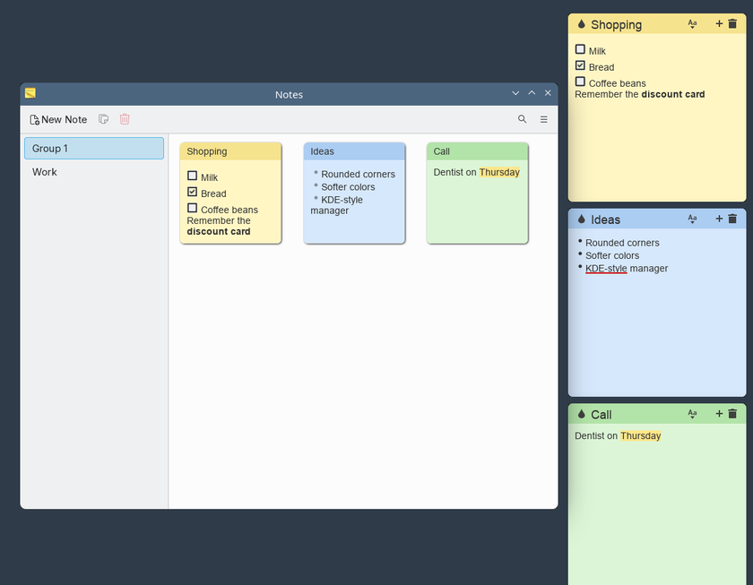

# Sticky, KDE-style

Fork of [linuxmint/sticky](https://github.com/linuxmint/sticky) that fits a KDE Plasma desktop on Fedora.



## Changes from upstream

- Notes with rounded corners, the same radius as Breeze windows, and a softer shadow
- Softer, pastel note colors and highlight
- The manager uses the KWin title bar instead of a GTK header bar, with a flat toolbar like the KDE applications (new, duplicate and delete on the left, search and menu on the right)
- Group list and Preferences sidebar with KDE-style selection
- Freedesktop icon names instead of the `xsi-*` icons, which Fedora does not ship, and an own bullet icon

## Install on Fedora

Download the RPM from the [releases](https://github.com/itotm/sticky/releases) and install it:

```
sudo dnf install --setopt=install_weak_deps=False ./sticky-*.noarch.rpm
```

Without weak dependencies, because `xapps` recommends `inxi`, which pulls in perl, ipmitool and freeipmi. On Fedora Atomic desktops use `rpm-ostree install` instead.

To build the RPM in a Fedora container with podman:

```
packaging/build-rpm.sh [fedora release]   # default: 44, output in dist/
```

The upstream README follows.

# Sticky (upstream)

Sticky is a note-taking app for the Linux desktop that simulates traditional "sticky note" style stationery on your desktop. Some of its features include basic text formatting (bold, italics, monospaced, etc.), spell-checking, a tray icon for controlling note visibility, color notes, manual and automatic backups, and a manager to organize your notes into groups. Sticky is written in Python, and uses the GTK3 toolkit


## How to build and install

### Download the source code and enter the source directory
```
# Clone this repo:
git clone https://github.com/collinss/sticky.git

# Enter the folder:
cd sticky
```
### Mint, Debian, Ubuntu and derivatives:
```
# Try to build. If this fails, it's probably due to missing dependencies.
# Take note of these packages, install them using apt-get:
dpkg-buildpackage --no-sign

# Once that succeeds, install:
cd ..
sudo dpkg -i sticky*.deb

# If this fails, make note of missing runtime dependencies (check list below),
# install them, repeat previous command (apt-get install -f may also work).
```
### Build and install using Meson
```
Sticky has support for the meson build system. See https://mesonbuild.com/Running-Meson.html for more details on using meson to build and install.
```
### Otherwise you can copy files directly to the file system:
```
sudo cp -r usr/* /usr/
sudo cp etc/xdg/autostart/sticky.desktop /etc/xdg/autostart/
sudo cp data/sticky.desktop.in /usr/share/applications/sticky.desktop
sed -i 's|@bindir@|/usr/bin|' data/org.x.sticky.service.in
sudo cp data/org.x.sticky.service.in /usr/share/dbus-1/services/org.x.sticky.service
```
> [!NOTE]
> This method doesn't install translations, so Sticky may not get translated if you install it this way.

#### runtime deps
- gir1.2-glib-2.0
- gir1.2-gtk-3.0 (>= 3.20.0)
- gir1.2-xapp-1.0 (>= 1.6.0)
- gir1.2-gspell-1
- python3
- python3-gi
- python3-xapp (>= 1.6.0)

## Controlling Sticky via DBUS
Sticky offers the following dbus methods and signals:
- 'ShowNotes' (method): toggles visibility and focus of the notes on the screen
- 'NewNote' (method): creates a new note containing the provided text
    - Takes 1 addtional argument containing the text of the new note
- 'NewNoteBlank' (method): creates a new empty note
- 'NotesChanged' (signal): indicates that the notes have changed in some way and the changes have been saved

### Command Line
You can use dbus-send to call dbus methods (and dbus-monitor for signals) at a command prompt, in a script, etc.
```
dbus-send --type=method_call --dest="org.x.sticky" /org/x/sticky org.x.sticky.ShowNotes
dbus-send --type=method_call --dest="org.x.sticky" /org/x/sticky org.x.sticky.NewNoteBlank
dbus-send --type=method_call --dest="org.x.sticky" /org/x/sticky org.x.sticky.NewNote string:'New note text'
dbus-monitor "type='signal',interface='org.x.sticky',member=NotesChanged"
```

## Translations
Please use Launchpad to translate Sticky Notes: https://translations.launchpad.net/linuxmint/latest/.

The PO files in this project are imported from there.

## License
- Code: GPLv2
